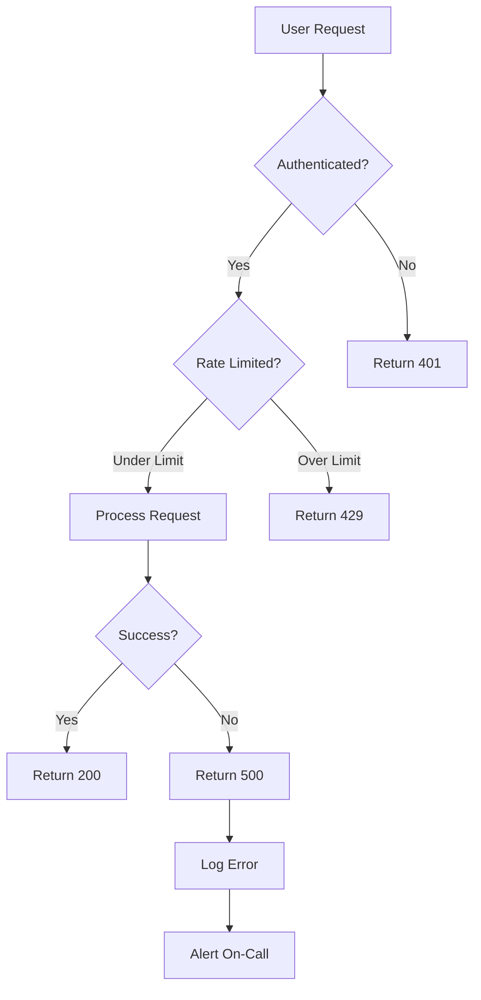
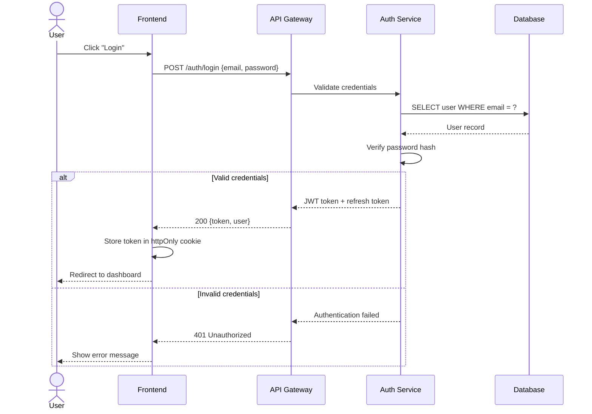
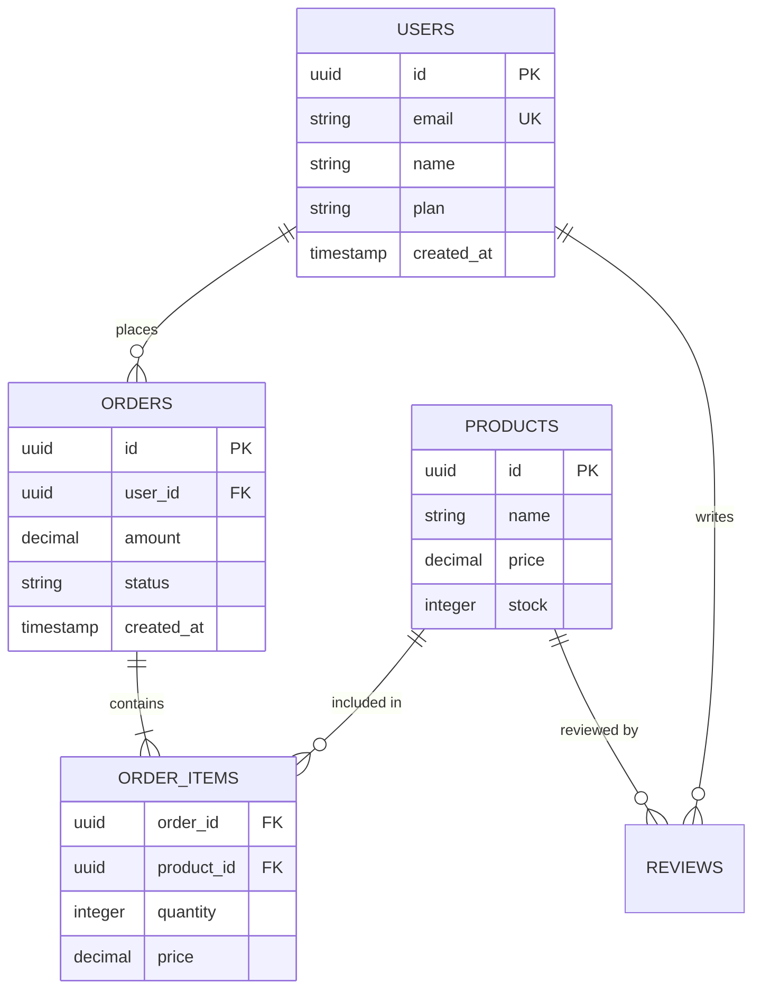
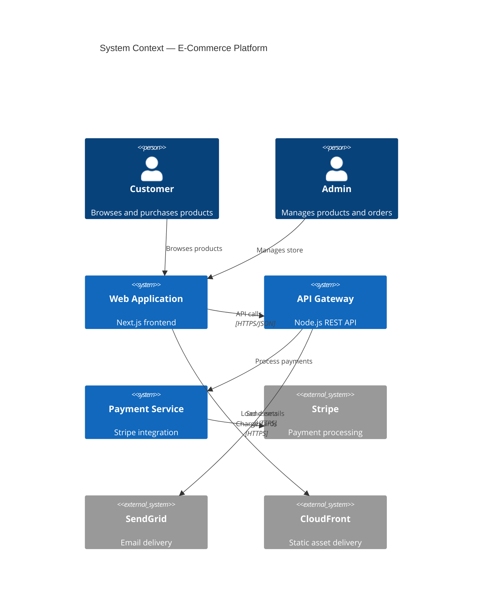
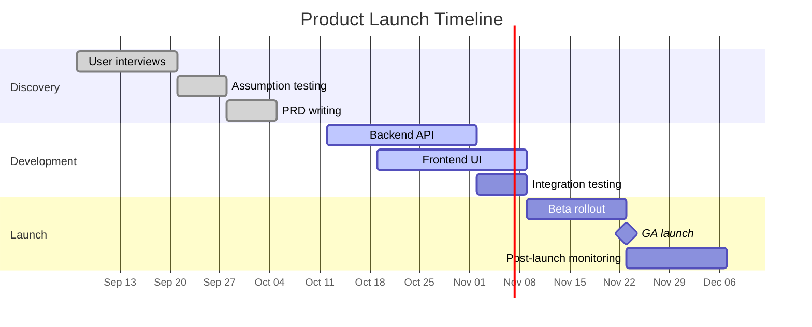
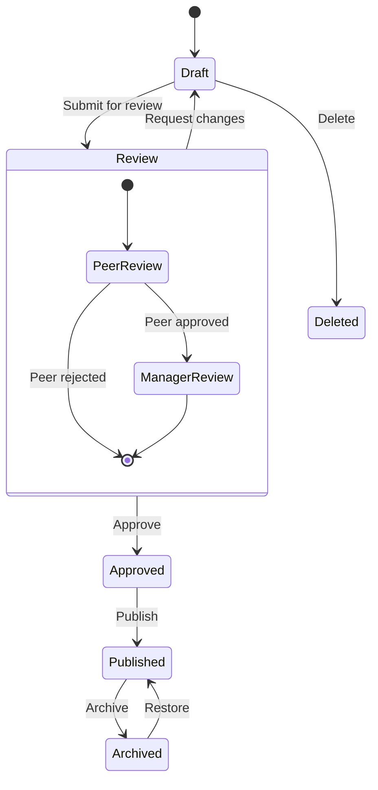
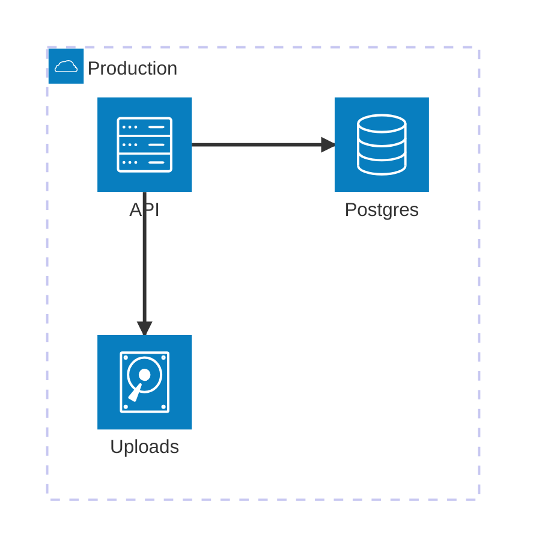
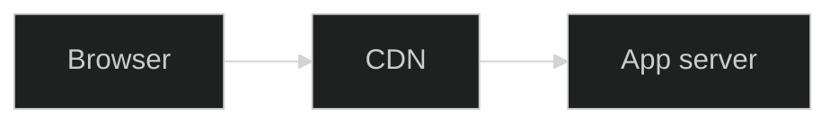

# Mermaid — Diagrams as Code in Markdown

## Overview

Mermaid (npm `mermaid`, 12.x in October 2026) renders diagrams from text. Write a fenced block tagged `mermaid` in any Markdown file and GitHub, GitLab and most documentation tools draw it; the text diffs and reviews like code. Newer diagram types may not render on a host that runs an older Mermaid, so check the target before using them.

## Instructions

Pick the diagram type by the question it answers: flowchart for decisions, sequence for who-calls-whom over time, ER for data models, state for lifecycles, Gantt for schedules. Write the definition, then validate it (see Rendering) before committing. The blocks below are all valid on Mermaid 12.

### Flowcharts



### Sequence Diagrams



### Entity Relationship Diagrams



### Architecture diagrams (C4, experimental)



### Gantt Charts



### State Diagrams



### Other types worth knowing

`classDiagram`, `pie`, `gitGraph`, `timeline`, `mindmap`, `journey`, `quadrantChart`, `xychart-beta`, `sankey-beta`, `kanban`, `block-beta`, `packet-beta`, `requirementDiagram`, `treemap-beta`, `radar-beta` and `architecture-beta` all parse in Mermaid 12. Example of an architecture diagram:



### Theme and configuration

Directives such as `%%{init: {...}}%%` are deprecated. Put configuration in YAML frontmatter at the top of the block:



### Rendering and validating

```bash
npm install -g @mermaid-js/mermaid-cli     # provides mmdc; downloads a headless Chromium
mmdc -i architecture.mmd -o architecture.svg
mmdc -i architecture.mmd -o architecture.png -t dark -b transparent
mmdc -i README.template.md -o README.md    # replaces mermaid blocks with rendered images
```

`mmdc` renders in a headless browser, so a diagram that does not parse will not produce an image; run it on changed files in CI to catch syntax errors.

### In a web page

```html
<pre class="mermaid">
flowchart LR
    A[Request] --> B[Handler]
</pre>
<script type="module">
  import mermaid from 'https://cdn.jsdelivr.net/npm/mermaid@12/dist/mermaid.esm.min.mjs';
  mermaid.initialize({ startOnLoad: true });
</script>
```

Pin a major version in the URL. In a bundled app, `npm install mermaid`, call `mermaid.initialize({ startOnLoad: false })` and then `await mermaid.run()`. Keep the default `securityLevel: 'strict'` unless you fully trust the diagram source.

## Examples

### Example 1: "Document our checkout API call flow in the README"

Write the sequence diagram above (adapting participants) in a `mermaid` fence in `README.md`, then preview the file on GitHub or render the diagram with `mmdc`. The result is a rendered diagram with the `alt`/`else` branches shown as labelled boxes.

### Example 2: "Generate an ER diagram from my Postgres tables"

Read the schema (`\d+ orders` in psql or the migration files), then emit one `erDiagram` entity per table with its columns and `PK`/`FK`/`UK` markers, and one relationship line per foreign key, such as `USERS ||--o{ ORDERS : places`. The cardinality markers are `||` exactly one, `|o` or `o|` zero or one, `o{` or `}o` zero or many, `|{` or `}|` one or many (the crow's foot points at the "many" side).

## Guidelines

- A node id or label that is the lowercase word `end` breaks flowcharts; write `End` or quote the label.
- Wrap labels containing parentheses, braces, quotes or `#` in double quotes: `B["Pay (card)"]`. Unquoted `B[Pay (card)]` is a parse error.
- Keep a diagram to what fits on one screen; split large systems into several diagrams.
- C4 diagrams are marked experimental upstream; their syntax may change between releases.
- Mermaid lays out automatically; if you need exact positioning, use a drawing tool instead.
- Do not paste untrusted user text into a diagram that renders with `securityLevel: 'loose'`.
