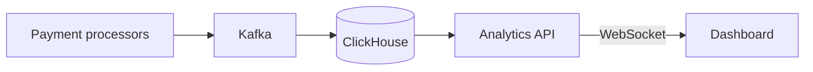

# Build a React Dashboard with Recharts, Plotly, and Mermaid Diagrams

Priya is an engineering lead at a 50-person fintech startup processing 2 million transactions per day. The operations team relies on a manually-updated Google Sheets dashboard that is always 12 hours stale. When a payment processor goes down, nobody knows until customers complain.

## The Problem

The CEO keeps asking, "Why can't I see what's happening right now?" Leadership makes decisions on day-old data. Outages go undetected for hours because there is no real-time visibility into transaction volumes, error rates, or revenue metrics. The ops team needs live dashboards, engineering needs documented architecture, and nobody has time to build it from scratch.

## The Solution

Priya's team builds a real-time analytics dashboard using Recharts (3.x) for interactive visualizations, Plotly (plotly.py) for deep-dive heatmaps, Mermaid for architecture diagrams, and Material for MkDocs for publishing internal documentation. The analytics API pushes a new point over a WebSocket every 30 seconds.

## Step-by-Step Walkthrough

### 1. Build the Dashboard Layout with Recharts

The dashboard has three sections: KPI cards at the top, time-series charts in the middle, and breakdown tables at the bottom. Install `recharts` (3.x; React 16.8 or newer) in the React or Next.js app. A small hook keeps a 24-hour window of points pushed over the WebSocket. Point the URL at your own analytics API through an environment variable (`wss://` in production):

```ts
// src/hooks/use-realtime-metrics.ts
"use client";
import { useEffect, useState } from "react";

export type MetricPoint = { timestamp: number; revenue: number };

export function useRealtimeMetrics(metric: string, windowHours = 24) {
  const [data, setData] = useState<MetricPoint[]>([]);
  const [isLive, setIsLive] = useState(false);

  useEffect(() => {
    const ws = new WebSocket(`${process.env.NEXT_PUBLIC_METRICS_WS_URL}?metric=${metric}`);
    ws.onopen = () => setIsLive(true);
    ws.onclose = () => setIsLive(false);
    ws.onmessage = (e) => {
      const point: MetricPoint = JSON.parse(e.data);
      const cutoff = Date.now() - windowHours * 3_600_000;
      setData((prev) => [...prev, point].filter((p) => p.timestamp >= cutoff));
    };
    return () => ws.close();
  }, [metric, windowHours]);

  return { data, isLive };
}
```

The revenue chart uses it. Revenue arrives in cents, so the axis and tooltip format it as compact dollars. In Recharts 3 a custom tooltip is typed with `TooltipContentProps`:

```tsx
// src/components/dashboard/revenue-chart.tsx
"use client";
import {
  AreaChart, Area, XAxis, YAxis, Tooltip, ResponsiveContainer,
  ReferenceLine, Brush, type TooltipContentProps,
} from "recharts";
import { useRealtimeMetrics } from "@/hooks/use-realtime-metrics";

const usd = (cents: number) =>
  (cents / 100).toLocaleString("en-US", {
    style: "currency", currency: "USD", notation: "compact",
  });

function RevenueTooltip({ active, payload, label }: TooltipContentProps) {
  if (!active || !payload?.length) return null;
  return (
    <div className="rounded border bg-white p-2 text-sm shadow">
      <div>{new Date(label as number).toLocaleTimeString()}</div>
      <strong>{usd(payload[0].value as number)}</strong>
    </div>
  );
}

export function RevenueChart() {
  const { data, isLive } = useRealtimeMetrics("revenue", 24);
  const average = data.length
    ? data.reduce((sum, p) => sum + p.revenue, 0) / data.length
    : 0;

  return (
    <div>
      <span aria-live="polite">{isLive ? "Live" : "Reconnecting..."}</span>
      <ResponsiveContainer width="100%" height={400}>
        <AreaChart data={data}>
          <defs>
            <linearGradient id="revenueGradient" x1="0" y1="0" x2="0" y2="1">
              <stop offset="5%" stopColor="#4f46e5" stopOpacity={0.4} />
              <stop offset="95%" stopColor="#4f46e5" stopOpacity={0} />
            </linearGradient>
          </defs>
          <XAxis dataKey="timestamp"
            tickFormatter={(ts) => new Date(ts).toLocaleTimeString([], {
              hour: "2-digit", minute: "2-digit",
            })} />
          <YAxis tickFormatter={usd} />
          <Tooltip content={RevenueTooltip} />
          <ReferenceLine y={average} stroke="#f59e0b" strokeDasharray="5 5" label="24h avg" />
          <Area type="monotone" dataKey="revenue"
            stroke="#4f46e5" fill="url(#revenueGradient)" />
          <Brush dataKey="timestamp" height={30} stroke="#4f46e5" />
        </AreaChart>
      </ResponsiveContainer>
    </div>
  );
}
```

The `Brush` at the bottom lets the ops team drag to zoom into the minutes around an incident.

### 2. Add an Error Rate Heatmap with Plotly

For deeper analysis, a Plotly heatmap shows error rates by hour and day of week. This reveals patterns like recurring spikes during batch jobs. The function lives in the analytics API (`pip install plotly pandas`) and returns the figure as JSON; the React app renders it with `react-plotly.js`, or you embed it in a Dash page:

```python
# analytics-api/heatmap.py
import plotly.graph_objects as go
import pandas as pd

def generate_error_heatmap(transactions_df: pd.DataFrame) -> str:
    df = transactions_df.copy()
    df["hour"] = df["timestamp"].dt.hour
    df["day"] = df["timestamp"].dt.day_name()
    df["failed"] = (df["status"] == "failed") * 100.0   # percent, per row

    pivot = df.pivot_table(values="failed", index="hour", columns="day", aggfunc="mean")
    days = ["Monday", "Tuesday", "Wednesday", "Thursday", "Friday", "Saturday", "Sunday"]
    pivot = pivot.reindex(columns=days)

    fig = go.Figure(go.Heatmap(
        z=pivot.values, x=pivot.columns,
        y=[f"{h:02d}:00" for h in pivot.index],
        colorscale="RdYlGn_r",
        texttemplate="%{z:.1f}%",
        colorbar={"title": "Error rate (%)"},
    ))
    fig.update_layout(title="Failed transactions by hour and weekday")
    return fig.to_json()
```

With 2 million transactions a day, query the hourly failed/total counts from the database and build the frame from those, rather than loading raw rows into pandas.

### 3. Document Architecture and Publish with MkDocs

The data pipeline (payment processors, Kafka, ClickHouse, WebSocket API) is documented with Mermaid diagrams that render in Material for MkDocs once the `mermaid` custom fence is enabled. Pin the version (`pip install "mkdocs-material==9.8.0"`, which needs Python 3.11 or newer; the theme is in maintenance mode, and its 9.8.0 CLI notice gives an end-of-life date of May 5, 2027 and points to the Zensical migration guide, so plan the move). In `mkdocs.yml`:

```yaml
site_name: FinFlow analytics
theme:
  name: material
markdown_extensions:
  - pymdownx.superfences:
      custom_fences:
        - name: mermaid
          class: mermaid
          format: !!python/name:pymdownx.superfences.fence_code_format
```

Then a page such as `docs/pipeline.md` can contain the diagram directly:

````markdown

````

`mkdocs build` writes the static site to `site/`. The docs include architecture overviews, runbooks for common incidents, and API references, all versioned in Git alongside the code. Publish them behind your company login, not on a public host.

## Real-World Example

Priya, engineering lead at FinFlow (an invented payment processing startup), ships the dashboard after a 3-week sprint:

1. She scaffolds the Recharts dashboard with KPI cards for revenue, transaction count, error rate, and P99 latency
2. The team adds the Plotly error heatmap and discovers that errors spike every Tuesday at 2 AM during a batch reconciliation job that locks the payments table
3. Architecture docs go live on Material for MkDocs at an internal address
4. The operations team now sees a payment processor outage within about 30 seconds instead of hearing about it from customers hours later
5. Engineering moves the Tuesday batch job to a replica; the error rate drops from 0.8% to 0.1% (the team's own numbers)
6. The CEO opens the live dashboard on his phone during board meetings

## Related Skills

- [recharts](../skills/recharts/SKILL.md) -- the live KPI and time-series charts
- [plotly](../skills/plotly/SKILL.md) -- the error-rate heatmap
- [mermaid](../skills/mermaid/SKILL.md) -- architecture diagrams
- [mkdocs](../skills/mkdocs/SKILL.md) -- publishing the internal docs site
